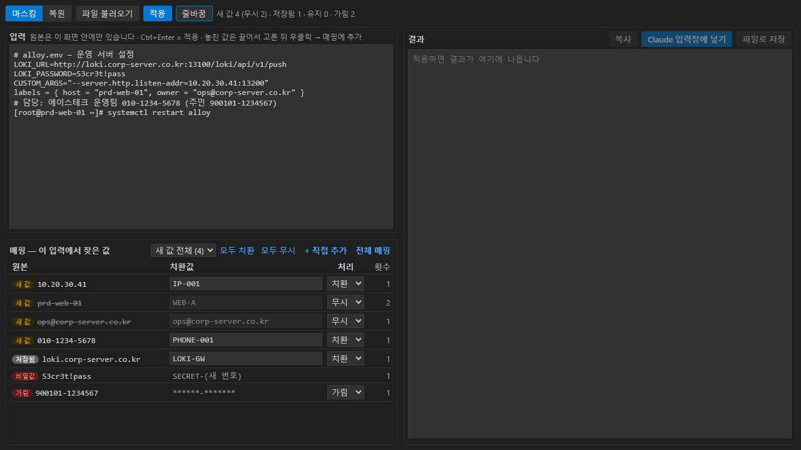
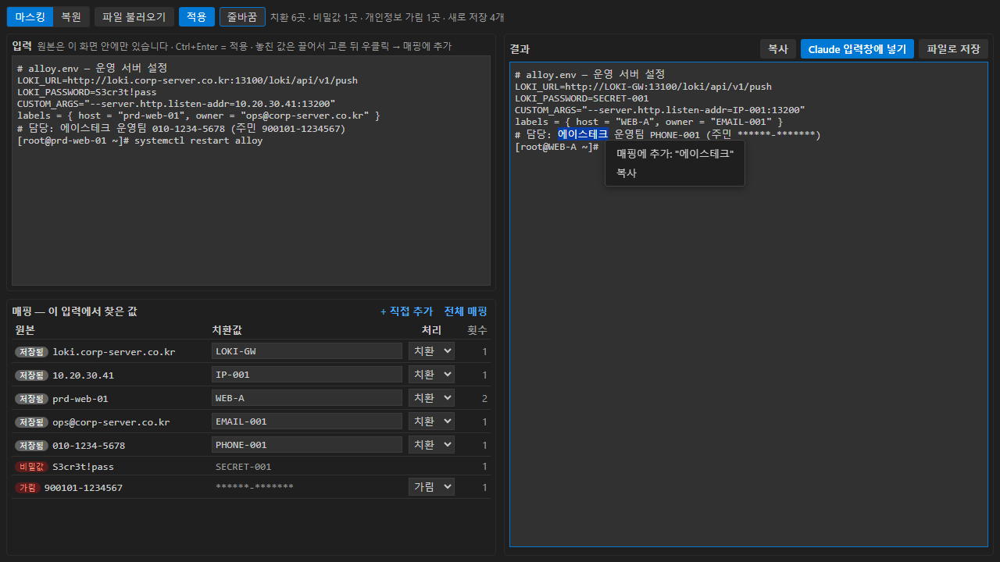
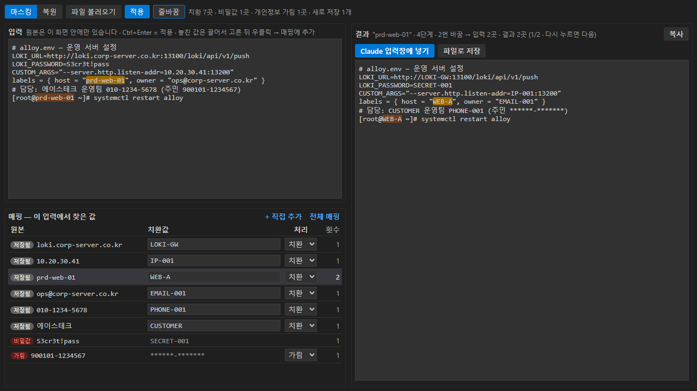
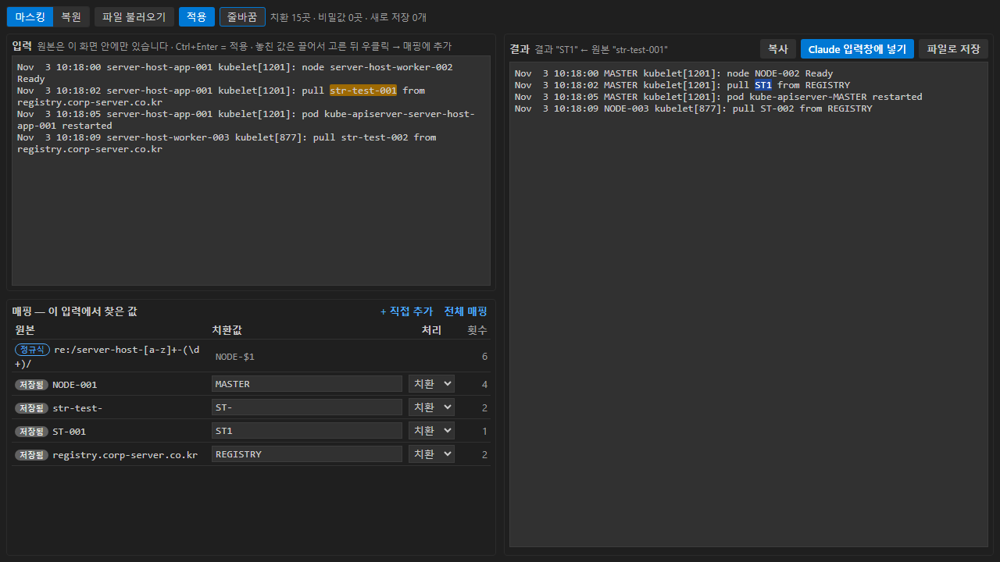
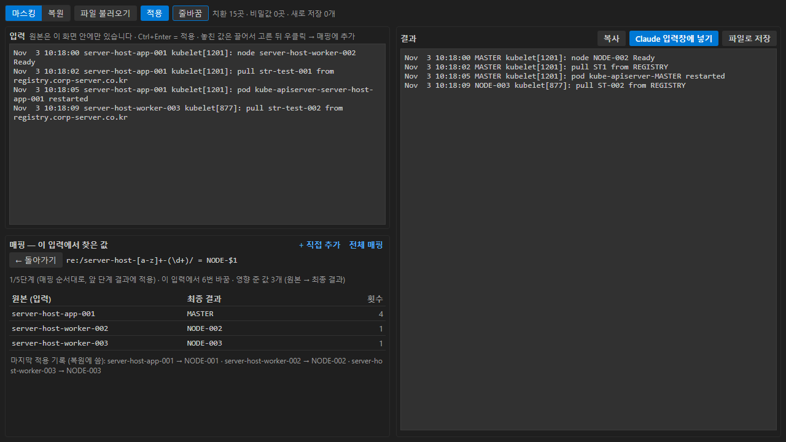
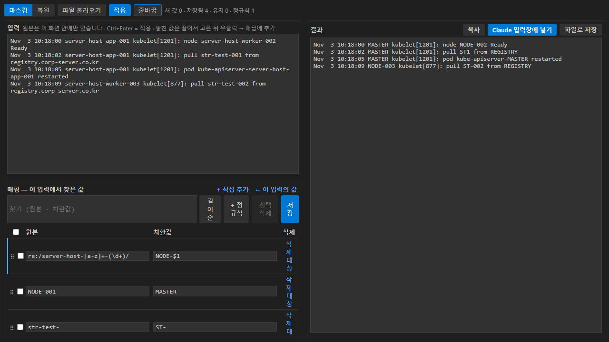
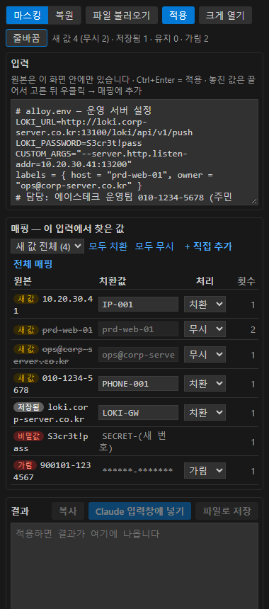
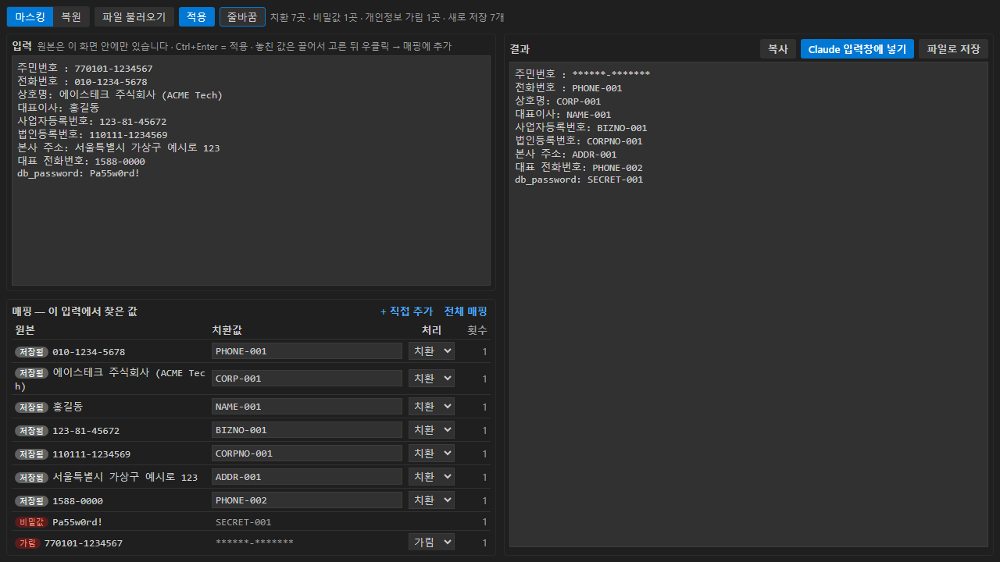
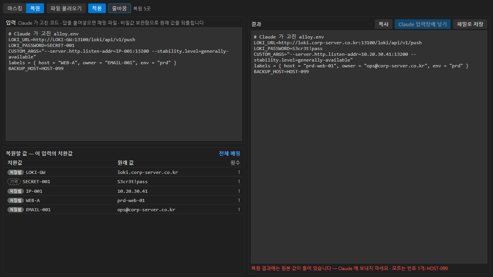
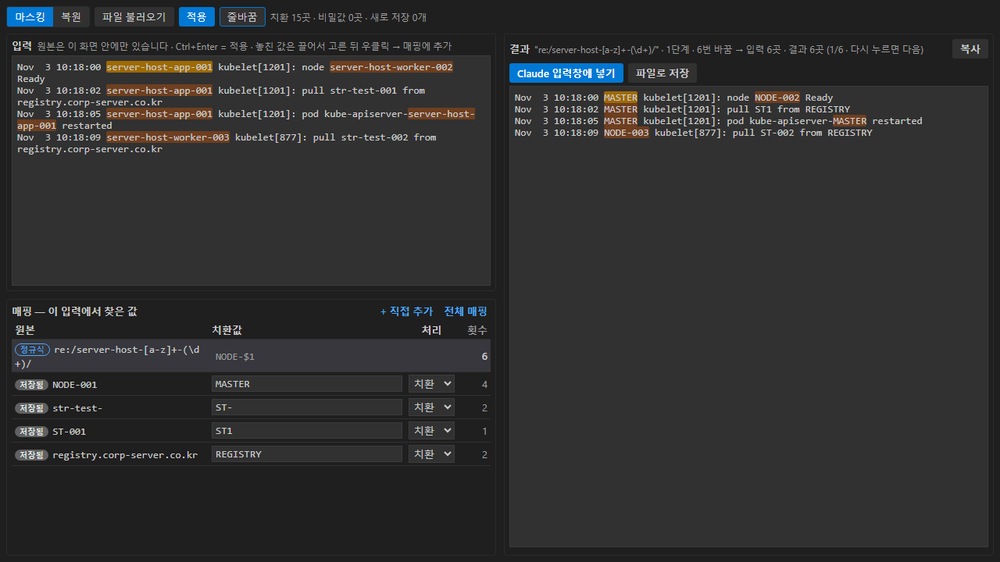

# Khai.Bleep — 삐- 처리(마스킹) · 복원

> **Bleep** — 방송에서 말하면 안 되는 말을 "삐-" 처리하듯이

설정 파일, 코드, 명령 출력, 로그를 **Claude 같은 외부에 넘기기 전에** IP · 호스트명 · 개인정보 · 비밀값을 "삐-" 처리(마스킹 — 매핑 파일 기준으로 치환 · 가림)하고, 작업이 끝나면 **원래 값으로 복원**하는 VS Code 확장입니다. Khai 도구 시리즈의 하나입니다 (예전 이름 Mask Hosts).


- 찾은 값은 **매핑 파일**(`원본=치환값`)에 남겨 늘 같은 이름으로 바꿉니다 — `prd-web-01` 은 언제나 `WEB-A`
- 비밀번호 · 토큰은 매핑 파일에 남기지 않고 `SECRET-001` 로 바꿔 **VS Code SecretStorage** 에만 기억합니다
- 주민번호 · 카드번호는 기본적으로 **가리기만** 합니다 (어디에도 저장하지 않음)
- 원본은 변환 화면 안에만 있고 편집기에 열리지 않습니다

**목차** — [1. 설치](#1-설치) · [2. 빠른 시작](#2-빠른-시작) · [3. 변환 화면](#3-변환-화면) · [4. 개인정보 · 비밀값](#4-개인정보--비밀값) · [5. 복원](#5-복원--작업한-결과를-원래-값으로) · [6. 명령](#6-명령) · [7. 찾는 규칙](#7-찾는-규칙) · [8. 매핑 파일](#8-매핑-파일) · [9. 설정](#9-설정) · [10. 주의](#10-주의)<!-- 소스에서만 --> · [11. 고칠 때](#11-고칠-때)<!-- /소스에서만 -->

---

## 1. 설치


<!-- 설치본에서만
```bash
code-server --install-extension khai.bleep-{version}.vsix
```

배포판과 같은 이름의 `khai.bleep-{version}.mhtml` 이 이 가이드입니다 (화면 이미지 포함 · 크롬 · 엣지로 열기).
-->

- VS Code 데스크톱: `code --install-extension …` 또는 확장 보기 → `…` → **VSIX에서 설치**
- 설치한 뒤 **Developer: Reload Window**
- 매핑 파일 위치를 정해 둡니다 (설정 `khai.bleep.mapFile`, 기본 `~/bleep-map.properties`). **작업 폴더 밖**에 둡니다

---

## 2. 빠른 시작

### ① 붙여넣기 — 찾은 값이 표에 나온다

왼쪽 활동 막대의 **Khai.Bleep 아이콘**(말풍선에 검은 막대) → 사이드바에 **변환** 화면이 열립니다. 넓게 쓰려면 **크게 열기**.

**입력**에 자료를 붙여넣으면 (또는 **파일 불러오기**) 잠시 뒤 **매핑** 표에 찾은 값이 나옵니다.



| 배지 | 뜻 |
|---|---|
| `새 값` | 매핑 파일에 없던 값 — 제안 번호(`IP-001` · `HOST-001` …)가 들어 있음 |
| `저장됨` | 매핑 파일에 있는 값 — 늘 같은 치환값 |
| `유지` | `원본=원본` 으로 저장된 값 — 바꾸지 않음 |
| `추가` | **+ 직접 추가** · 우클릭으로 넣은 값 |
| `가림` · `번호` · `비밀값` | 매핑 없이 가리는 값 (주민번호 · session · 비밀번호) — 읽기 전용, [4장](#4-개인정보--비밀값) |

- **치환값** 칸을 고치면 그 이름으로 바뀝니다 (예: `HOST-001` → `WEB-A`)
- **처리** 로 값마다 어떻게 할지 고릅니다 — 매핑 파일에 저장되어 다음에도 같게 처리됩니다

  | 처리 | 결과 | 매핑 파일 | 복원 |
  |---|---|---|---|
  | 치환 | `HOST-001` · `WEB-A` 같은 번호 · 이름 | `원본=치환값` | 됨 |
  | 가림 | `****` | `원본=****` | 안 됨 (`****` 그대로) |
  | 유지 | 원본 그대로 (다시 묻지 않음) | `원본=원본` | — |
  | 무시 | 원본 그대로 — **이번만** (새 값에만 있음) | 저장 안 함 (다음에 또 나옴) | — |

  가린 개인정보 행(`가림` · `번호`)도 **치환** 으로 바꿀 수 있습니다 — 그 값은 매핑 파일에 평문으로 저장되고 `RRN-001` 처럼 바뀝니다. 비밀값 행은 바꿀 수 없습니다 (언제나 보관함)
- **새 값의 처음 처리** (설정 `khai.bleep.newValues`)
  - 기본 `guess`: 생김새로 추정한 값(호스트명 · 사용자 · 이메일)은 오탐일 수 있어 **무시**로 시작합니다. 확실한 값(IP · 전화 · 라벨 개인정보 · [사용자 규칙](#사용자-규칙-khaibleeprules)으로 찾은 값)은 **치환**으로 시작합니다
  - `ignore`: 사용자 규칙 값 말고는 모두 무시로 · `map`: 모두 치환으로 (예전 동작)
  - 무시한 값은 결과에 원본이 그대로 남습니다 — 적용하면 결과 아래에 무시한 값이 보입니다
- **모두 치환 · 모두 무시** (표 위, 새 값이 2개 이상일 때): 새 값 전체 또는 종류(`IP` · `HOST` …)를 골라 한꺼번에 바꿉니다. 로그처럼 줄마다 값이 다를 때 씁니다
  - 로그의 개인정보를 매핑 파일에 쌓고 싶지 않으면 그 규칙을 `session` 으로 ([4장](#4-개인정보--비밀값))
- **횟수**: 새 값은 입력에 나온 횟수, 매핑 행은 **그 매핑이 바꾼 횟수** (앞 단계가 만든 값을 바꾼 것 포함 — [단계 치환](#순서대로-한-단계씩--단계-치환))

### ② 적용 — 결과를 확인한다

**적용** (Ctrl+Enter) 을 누르면 새 값 · 고친 값이 매핑 파일에 저장되고 **결과**가 나옵니다. 위쪽에 치환 · 비밀값 · 개인정보 가림 · 새로 저장한 개수가 보입니다.


- 표가 입력을 못 따라왔어도 찾은 새 값은 자동 번호로 가립니다 (원본이 결과에 남지 않게)
- 입력을 고치면 결과가 흐려지고, 다시 적용하기 전에는 보낼 수 없습니다

### ③ 보내기

**Claude 입력창에 넣기** → 결과를 복사하고 Claude 입력창으로 커서를 옮깁니다. **Ctrl+V** 하고 보내면 됩니다.
(Claude Code 확장에는 입력창에 글을 직접 넣는 명령이 없어 붙여넣기만 손으로 합니다)

**복사** · **파일로 저장** 도 있습니다.

---

## 3. 변환 화면

### 놓친 값 추가 — 끌어서 고르고 우클릭

결과를 훑다가 남아 있는 원본(회사명, 사람 이름 …)을 보면, **입력이나 결과 창에서 끌어서 고른 뒤 우클릭 → 매핑에 추가**.



- 표에 다음 번호(`WORD-001` …)로 들어갑니다 — 치환값을 고치고 다시 **적용**
- 이미 매핑 파일에 있으면 그 치환값이 들어갑니다
- 기호가 든 값도 됩니다: `:13100` · `(주)에이스` · `"web01"` · `admin@acme` · `x=y` · `#tag`
- 여러 줄은 넣을 수 없습니다
- **+ 직접 추가** 로 원본 · 치환값을 손으로 적어도 됩니다

### 어디가 바뀌었나 — 행을 누르면 입력 · 결과에서 강조

매핑 표의 행을 누르면 **입력**에서 그 매핑이 영향 준 원본 자리와 **결과**에서 그 자리가 최종적으로 된 곳이 함께 칠해지고 첫 자리로 스크롤됩니다. 같은 행을 다시 누르면 둘 다 다음 자리로 갑니다 (`1/2` → `2/2`). 위쪽에 몇 번째 단계인지 · 몇 번 바꿨는지가 보입니다.



- 치환값 칸 · 처리 칸을 누를 때는 고르지 않습니다
- 무시한 값은 결과에 그대로 남은 자리, 가린 값(`가림` · `비밀값`)은 결과의 `****` · `SECRET-001` 자리를 칠합니다
- 정규식 행도 입력의 원본 자리와 결과의 바뀐 자리를 함께 칠합니다
- **배지**(`저장됨` · `유지` · `정규식`)를 누르면 [상세](#매핑-상세): 그 매핑이 영향 준 값(원본 → 최종 결과) · 횟수
- 입력을 고치면 입력 쪽 강조는 다시 찾은 뒤(잠시 뒤) 다시 그려지고, 결과 쪽은 다시 적용한 뒤 그려집니다

### 고른 글 ↔ 다른 쪽 자리

적용한 뒤 **입력에서 글을 끌어 고르면** 결과에서 그 부분이 된 자리가, **결과에서 고르면** 입력의 원본 자리가 칠해집니다 (위쪽에 `입력 "str-test-001" → 결과 "ST1"`). 비밀값 `****` 를 고르면 원래 어떤 값이었는지 입력에서 보입니다. 입력을 고친 뒤에는 다시 적용해야 합니다



### 매핑 상세

배지나 전체 매핑의 **대상** 을 누르면 그 매핑이 **지금 입력에서** 영향 준 값을 `원본 (입력) → 최종 결과 · 횟수` 로 보여 줍니다. 뒤 단계에서 또 바뀐 값은 최종 모습으로 보입니다 (`str-test-` → `ST1`). 위의 유지 줄에 막혀 바꾸지 못한 것, 마지막 적용 기록도 보입니다. 전체 매핑에서 고치는 중인(저장 전) 원본 · 치환값으로 미리 볼 수 있습니다. **← 돌아가기**



### 전체 매핑

표 위의 **전체 매핑** → 매핑 파일 전체를 찾기 · 고치기 · 삭제하고 **저장**. 매핑 파일의 주석과 줄 순서는 그대로 둡니다.



- **원본 · 치환값** 칸을 모두 고칠 수 있습니다. 원본을 바꾸면 그 줄 자리에서 바뀌고, 다른 원본과 겹치면 저장하지 않고 알려 줍니다
- **일괄 삭제**: 줄 앞 체크 → **선택 삭제**. 제목줄 체크는 **찾기에 걸린 줄만** 모두 고릅니다 (예: `server-host-` 로 찾고 모두 체크 → 선택 삭제). 다시 누르면 되살림
- **순서**: ⠿ 를 끌어서 바꿉니다 · **길이순** 으로 긴 원본 먼저 정렬 · 위의 줄에 가려진 줄은 노란 표시 ([단계 치환](#순서대로-한-단계씩--단계-치환))
- 모든 줄에 **대상** — 그 매핑이 지금 입력에서 영향 준 값 · 횟수 ([매핑 상세](#매핑-상세))
- 고친 것 · 지울 것 · 순서는 아래에 보이고, **저장** 해야 매핑 파일에 반영됩니다 (주석 · 빈 줄은 그 자리에)

### 줄바꿈

제목줄의 **줄바꿈** 버튼으로 입력 · 결과 창의 긴 줄 접기를 켜고 끕니다 (다시 열어도 유지).

### 사이드바 · 크게 열기

사이드바에서는 입력 → 매핑 → 결과가 위아래로 쌓입니다. **크게 열기** 를 누르면 편집기 영역에 왼쪽(입력 · 매핑) · 오른쪽(결과)으로 넓게 열리고, 입력하던 내용이 넘어갑니다.



---

## 4. 개인정보 · 비밀값



### 처리 방식

| 방식 | 결과 | 매핑 파일 | 복원 |
|---|---|---|---|
| `map` | `PHONE-001` | 저장 | 됨 |
| `session` | `RRN-S001` (같은 값은 같은 번호) | 저장 안 함 — 확장 메모리에만 | 창을 다시 불러오기 전까지 |
| `redact` | `******-*******` (숫자만 `*`, 라벨 · 사용자 규칙은 `****`) | 저장 안 함 | 안 됨 |
| `off` | 찾지 않음 | | |

### 내장 규칙 (`khai.bleep.builtinRules`)

| 규칙 | 찾는 것 | 기본 |
|---|---|---|
| `rrn` | 주민 · 외국인등록번호 `770101-1234567` · `7701011234567` | `redact` |
| `phone` | 전화번호 `010-1234-5678` · `02-123-4567` · `070-…` (하이픈 필수) | `map` |
| `card` | 카드번호 16자리 (Luhn 검사) | `redact` |
| `bizno` | 사업자등록번호 `123-81-45672` (체크섬 검사) | `map` |
| `corpno` | 법인등록번호 `110111-1234569` (체크섬 검사) | `map` |
| `tel` | 라벨 **전화 · 전화번호 · 연락처 · 휴대폰 · 팩스 · 대표번호** 뒤의 번호 — `1588-0000` · 하이픈 없는 번호도 | `map` |
| `name` | 라벨 **성명 · 이름 · 대표자 · 대표이사 · 담당자 · 고객명 · 예금주** 뒤의 값 | `map` |
| `corp` | 라벨 **상호 · 상호명 · 회사명 · 법인명 · 업체명** 뒤의 값 | `map` |
| `addr` | 라벨 **주소**(본사 주소 · 사업장 주소 포함) **· 소재지 · 도로명주소** 뒤의 값 | `map` |

- 라벨 규칙은 `성명: 홍길동` · `"주소": "…"` · `대표 전화번호 = 1588-0000` 처럼 **라벨 바로 뒤의 값을 통째로** 잡습니다. 영어 `name` · `address` 는 K8s YAML · IP 주소와 겹쳐서 넣지 않았습니다 — 필요하면 [사용자 규칙](#사용자-규칙-khaibleeprules)으로
- **주민번호를 `redact` 로 두는 이유**: 매핑 파일은 평문이라 `map` 이면 쓸수록 주민번호 목록이 쌓입니다. 행끼리 같은 사람인지 구분해야 하면 `session`
- 주민번호 체크섬은 보지 않습니다 (2020.10 이후 발급분은 맞지 않음)
- 법인등록번호는 주민번호와 형식이 같습니다. `법인등록번호:` 라벨이 붙고 체크섬이 맞으면 법인번호, 그 밖에 주민번호 형식이면 주민번호로 가립니다 (주민번호가 매핑 파일에 들어가지 않게)

```jsonc
// 예: 주민번호는 session 번호로, 이름은 찾지 않기
"khai.bleep.builtinRules": { "rrn": "session", "name": "off" }
```

### 사용자 규칙 (`khai.bleep.rules`)

내장 규칙 · 호스트 탐지보다 **먼저** 적용됩니다.

```jsonc
"khai.bleep.rules": [
  // 필드: 그 키의 값을 통째로 ("address": "…" · address: … · customer.address=…). 대소문자 무시
  { "kind": "ADDR", "keys": ["address", "addr1"] },
  // 필드 + 패턴: 값이 패턴에 맞을 때만
  { "kind": "NAME", "keys": ["name"], "pattern": "^[가-힣]{2,4}$", "action": "session" },
  // 정규식: group 을 주면 그 캡처 그룹만 바꾼다
  { "kind": "EMPNO", "pattern": "사번[: ]*(E\\d{6})", "group": 1 }
]
```

| 항목 | 뜻 |
|---|---|
| `kind` | 치환값 접두어 (`ADDR` → `ADDR-001`). 영문 대문자로 시작 |
| `keys` | 이 키(라벨)의 값 |
| `pattern` · `flags` · `group` | 정규식 (JavaScript) · 플래그(`i` `m` `s` `u`) · 바꿀 캡처 그룹 |
| `action` | `map` (기본) · `session` · `redact` · `off` |
| `name` | 화면에 보일 규칙 이름 |

- 따옴표 없는 필드 값은 줄 끝까지 (끝의 `,` `;` `}` 와 ` #` 주석은 뺌). YAML 블록(`|` · `>`) · 객체 · 배열은 건너뜁니다
- 잘못된 규칙(정규식 오류 등)은 경고를 띄우고 건너뜁니다

### 비밀값

password · passwd · secret · token · api_key · authorization 같은 키의 값, `PW` · `PWD` · `PASS` 키(`db_pw` · `SMTP_PASS` 처럼 끝 마디일 때), 한글 **암호 · 비밀번호 · 패스워드 · 비번** 키(`DB 비밀번호:` · `관리자암호=` — `암호화` 는 제외), K8s env 의 `name: *_PASSWORD` 다음 `value:`, URL 의 `user:pass@`, 개인키 블록.

- `SECRET-001` 로 바꾸고 원래 값은 **VS Code SecretStorage**(OS 키체인으로 암호화)에만 기억합니다 — 매핑 파일에는 남기지 않습니다
- 같은 비밀값은 어느 파일에 나와도 같은 번호
- 설정 `khai.bleep.restoreSecrets` 를 끄면 `****` (복원 불가)
- **복원용으로 기억한 비밀값 지우기** 명령으로 비웁니다
- code-server 에서는 SecretStorage 가 브라우저 쪽 저장소를 쓸 수 있어, 환경에 따라 창을 다시 불러오면 비어 있을 수 있습니다

---

## 5. 복원 — 작업한 결과를 원래 값으로

마스킹한 코드 · 설정을 Claude 가 고쳐 주면, 그 결과를 다시 원래 값으로 되돌려 실제로 씁니다.

```
원본 프로젝트 ─마스킹 사본─▶ proj-masked/ ─Claude 가 고침─▶ proj-masked/ ─복원 사본─▶ proj-restored/ (또는 원본 폴더)
```

### 변환 화면에서

**복원** 탭 → Claude 가 고친 코드 · 답을 붙여넣고 **적용**.



- `HOST-001` · `SECRET-001` · `RRN-S001` 같은 치환값이 원래 값으로 바뀝니다 (`기억` 배지 = 보관함 · session 에서 온 값)
- 되돌리지 못한 것은 결과 아래에 알려 줍니다
  - **모르는 번호** — 매핑 · 보관함에 없는 `HOST-099` 같은 값 (Claude 가 새로 만든 이름 등)
  - **`****`** — `redact` 로 가린 값. 원래 값을 저장하지 않았으므로 직접 채웁니다
- 결과에 원본이 들어 있으므로 **Claude 입력창에 넣기** 는 막힙니다

### 파일 · 폴더 단위로

1. 원본 폴더 우클릭 → **파일 · 폴더 → 마스킹 사본 만들기** → `proj-masked/`
2. Claude 와 `proj-masked/` 에서 작업
3. `proj-masked/` 우클릭 → **파일 · 폴더 → 복원 사본 만들기** → `proj-restored/`
   - 파일 · 폴더 이름도 되돌립니다
   - 출력 폴더를 원본 프로젝트로 적으면 바로 덮어씁니다 (같은 이름 파일이 있으면 확인)

편집기 · 클립보드는 **현재 편집기 복원**(결과는 새 탭) · **클립보드 복원**.

> 직접 고른 치환값(`WEB-A` 등)이 코드의 다른 단어와 같으면 그 단어도 바뀝니다 — 자동 번호(`HOST-001`)가 안전합니다

---

## 6. 명령

명령 팔레트에서 `Khai.Bleep:` 으로 찾습니다.

| 명령 | 메뉴 | 하는 일 |
|---|---|---|
| 변환 화면 크게 열기 | 변환 화면 제목줄 | 편집기 영역에 변환 화면 |
| 파일 · 폴더 → 마스킹 사본 만들기 | 탐색기 우클릭 · 변환 화면 제목줄 | `<이름>-masked/` 에 사본. 원본은 편집기에 열리지 않고 파일 · 폴더 이름도 치환. 팔레트에서 실행하면 작업 폴더 밖도 고를 수 있음 |
| 현재 편집기 치환 | 편집기 우클릭 | 붙여넣은 새 탭은 그 자리에서 (Ctrl+Z 로 되돌림), 디스크 파일은 결과를 옆 새 탭에. 선택 영역이 있으면 그 부분만 |
| 클립보드 치환 | — | 복사한 내용을 바꿔 클립보드에 다시 |
| 파일 · 폴더 → 복원 사본 만들기 | 탐색기 우클릭 · 변환 화면 제목줄 | `<이름>-restored/` 에 원래 값으로 |
| 현재 편집기 복원 | 편집기 우클릭 | 선택 영역 · 전체를 되돌려 새 탭에 |
| 클립보드 복원 | — | 복사한 내용을 되돌려 클립보드에 다시 |
| 매핑 파일 열기 | — | 매핑 파일을 편집기로 |
| 복원용으로 기억한 비밀값 지우기 | — | 비밀값 보관함 · session 번호를 비움 (확인 후) |
| 사용 설명서 열기 | 변환 화면 제목줄 `…` | 화면 이미지가 든 이 설명서를 마크다운 미리 보기로 (확장 보기의 DETAILS 는 보안 정책상 로컬 이미지를 보여 주지 못함) |

### 명령에서 새 값을 물을 때

변환 화면이 아닌 명령(사본 · 편집기 · 클립보드)은 매핑에 없는 값을 입력창으로 묻습니다. 처음에 **하나씩 정하기 / IP 는 자동 번호, 나머지만 / 전부 자동 번호** 중 고르고, 입력창 아래에 위치와 앞뒤 문맥이 보입니다.

| 입력 | 결과 |
|---|---|
| Enter | 제안값 (`IP-001` · `HOST-001` · `PHONE-001` …) |
| 직접 입력 | 그 값 (예: `WEB-A`) |
| `-` | 그대로 둔다 (`원본=원본` 으로 저장, 다시 묻지 않음) |
| `!` | 가림 (`원본=****` 로 저장) |
| `*` | 남은 값은 전부 제안값 |
| Esc | 중단. 그때까지 정한 값은 매핑 파일에 남고, 사본은 만들지 않음 |

설정 `khai.bleep.askNewValues` 를 끄면 묻지 않고 자동 번호로 넣습니다.

---

## 7. 찾는 규칙

| 규칙 | 예 |
|---|---|
| IPv4 | `10.20.30.41` · `10.20.30.41:9100` · `172.16.0.0/16` (0.0.0.0 · 127.x · 255.x 제외) |
| URL 호스트 | `http://loki.corp-server.co.kr:13100/...` |
| 키 값 | `host = "web01"` · `hostname: web01` · `nodeName: w01` · `instance="web01:9100"` · `"host":"web01"` · `HOSTNAME=web01` |
| `"이름:포트"` | `"web01:9100"` |
| FQDN | `db01.corp-server.co.kr` (끝자리가 com · net · org · io · kr · local · corp · internal · lan 등) |
| 이메일 | `ops@corp-server.co.kr` |
| 셸 프롬프트 | `[user_name@host-001 ~]#` → 사용자 `USER-001` · 호스트 `HOST-001` (root · ubuntu · ec2-user 같은 공용 계정은 제외) |
| syslog | `Nov  2 10:18:00 web01 systemd[1]: …` |
| 개인정보 · 비밀값 | [4장](#4-개인정보--비밀값) |

- **호스트 키 이름**: host · hostname · node · nodename · instance · server · fqdn · address · addr. 접두어가 붙어도 됩니다 (`k8s_node_name` · `kubernetes.io/hostname` · `listen-addr`)
- **제외**: localhost, `*.svc` · `*.cluster.local`, 공개 도메인 (kubernetes.io · grafana.com · github.com · docker.io 등). 설정 `khai.bleep.keepDomains` 로 더합니다

### 치환 규칙

매핑 파일 전체(직접 추가한 단어 포함)를 적용합니다. 긴 원본이 먼저입니다.

- 원본의 첫 글자가 영문 · 숫자면 그 **앞**이, 끝 글자가 영문 · 숫자면 그 **뒤**가 영문 · 숫자가 아닐 때만 바꿉니다
  - `web01` → `web011` 은 그대로 · `vm-web01` → `vm-HOST-001`
- 기호로 시작 · 끝나는 원본(`:13100` · `(주)에이스` · `"web01"` · `/opt/acme/`)은 앞뒤가 무엇이든 바꿉니다
- 원본과 치환값이 같은 기호로 시작 · 끝나면 그 기호는 그대로 두고 조건으로만 봅니다 — 두 매핑이 기호를 나눠 쓸 수 있습니다
  - `root@=USER@` + `@a1b2c3d4e5f6=@hash-index` → `root@a1b2c3d4e5f6` 가 `USER@hash-index`
- **인코딩**: UTF-8(BOM 포함) · UTF-16LE 는 그대로 다시 씁니다. 그 밖(CP949 등)은 바이트를 그대로 보존합니다. 바이너리 · 64MB 넘는 파일은 건너뜁니다

---

## 8. 매핑 파일

```properties
# 원본=치환값 (한 줄에 하나, UTF-8)
10.20.30.41=IP-001
prd-web-01=WEB-A
# 원본=원본 → 그대로 둠
log-gateway=log-gateway
# 원본=**** → 가림 (복원하지 않음)
legacy-db01=****
# 단어 · 기호도 된다
에이스테크=CUSTOMER
(주)에이스=CUSTOMER
:13100=:PORT
root@=USER@
x\=y=EXPR-1
```

- 위치: 설정 `khai.bleep.mapFile` (기본 `~/bleep-map.properties`, 예전 `~/mask-map.properties` 가 있으면 그것). 처음 만들 때 권한 600
- `#` · `!` 로 시작하는 줄은 주석 (값 뒤에 붙인 주석은 지원하지 않음)
- 원본의 `=` 는 `\=`, 맨 앞의 `#` · `!` 는 `\#` · `\!` (화면 · 명령으로 넣으면 자동으로 붙음)
- 여러 줄 · `\` 다음에 `= # !` 가 오거나 `\` 로 끝나는 원본은 넣을 수 없습니다
- **넘기지 않습니다**: 원본 값이 들어 있으므로 작업 폴더 밖에 둡니다
- 같은 매핑 파일을 계속 쓰면 같은 서버는 늘 같은 이름 — 받은 쪽이 `WEB-A` 라고 하면 매핑 파일에서 원래 서버를 찾습니다

### 순서대로 한 단계씩 — 단계 치환

매핑은 **위에서부터 한 줄씩** 적용되고, 각 줄은 **앞 줄들이 바꾼 결과**에 적용됩니다. 고정값 줄과 [정규식 줄](#정규식-줄)이 섞여 있어도 목록 순서 그대로입니다.

```properties
re:/server-host-[a-z]+-(\d+)/=NODE-$1   # 1단계: server-host-app-001 → NODE-001
NODE-001=MASTER                     # 2단계: 정규식의 결과를 고정값으로 → MASTER
re:/MASTER/=M                       # 3단계: 다시 정규식 → M
```



```properties
str-test-=ST-        # 1단계: str-test-001 → ST-001
ST-001=ST1           # 2단계: ST-001 → ST1         (원문 str-test-001 의 최종 결과는 ST1)
```

- **유지**(`원본=원본`)는 그 자리를 막아 아래 줄이 바꾸지 못하게 합니다

  ```properties
  server-host-worker-002=server-host-worker-002   # 위: 002 는 그대로
  server-host-worker-=WRK-                    # 아래: 나머지 server-host-worker-003 … → WRK-003
  ```
- 적용할 때마다 단계별로 바꾼 것(매핑 · 원본 · 바뀐 값 · 횟수)을 매핑 파일 옆 `<매핑 파일>.last.json` 에 **새로** 남깁니다 (마지막 적용만, 권한 600, 원본이 들어 있음 — 사본 만들기에서는 빠짐). 상세 화면의 "마지막 적용 기록" 과 정규식 복원에 씁니다
- **복원은 역순**: 매핑 줄을 아래부터 되돌립니다 (정규식 줄은 변환 기록으로) — `ST1` → `ST-001` → `str-test-001`
- 속도: 고정값은 줄을 넘지 않으므로 줄마다 그 줄에 나오는 매핑만 순서대로 적용합니다 (결과는 글 전체에 한 단계씩 한 것과 같음). 2.6MB · 매핑 2,800줄에서 약 1초

- 새로 저장되는 값은 자기를 가리는 짧은 키(앞부분이 같은 키)가 있으면 **그 위**에 들어갑니다
- 전체 매핑에서 **⠿ 를 끌어** 순서를 바꾸고, 위의 줄에 가려 쓰이지 않는 줄은 노란 표시 · `가려진 줄 N` 으로 알려 줍니다. **길이순** 은 긴 원본 먼저로 한 번에 정렬합니다 (예전 동작)

### 정규식 줄

이름 규칙이 있는 값(`server-host-worker-001` · `-002` …)은 하나씩 넣지 않고 정규식 한 줄로 바꿉니다.

```properties
re:/server-host-worker-(\d+)/=WRK-$1
re:/server-host-[a-z]+-\d+/=NODE-{n}
re:/\bstg-[a-z0-9-]+\b/i=STG-HOST
```

- 형식: `re:/정규식/플래그=치환값`. 플래그는 `i` `m` `s` `u`. 정규식 안의 `=` 는 `\=`
- 치환값: `$1` · `$<이름>` (괄호로 잡은 부분) · `$&` (찾은 글 전체) · `{n}` (이 정규식에서 찾은 서로 다른 값의 번호 `001` `002` …) · `$$` (`$` 글자)
- **순서**: 고정값 줄과 섞여 목록 순서대로, 앞 단계의 결과에 적용합니다 (위의 고정값이 만든 `HOST-001` 도 정규식에 걸릴 수 있음 — 넓은 정규식은 상세에서 확인). 유지 자리는 건드리지 않습니다
  - 매핑(고정값 · 정규식)이 이미 바꾸는 값은 새 값으로 묻지 않습니다. 표에는 정규식마다 `정규식` 행 하나 (횟수 = 바꾼 횟수) — 매핑 파일에 쌓이지 않음
- **복원**: 매핑 줄을 아래부터 역순으로 되돌릴 때, 정규식 줄은 적용할 때 남긴 [변환 기록](#순서대로-한-단계씩--단계-치환)으로 되돌립니다
  - 기록은 마지막 적용 것만 남습니다 — 그 전 결과의 정규식 값은 되돌리지 못할 수 있습니다
  - 바뀐 값이 같은데 원본이 여럿(`WEB` ← `web02` · `web03`)이면 되돌리지 않고 알려 줍니다. 되돌려야 하면 `$1` · `{n}` 으로 구분되게 만듭니다
- 전체 매핑에서:
  - **+ 정규식** 으로 줄 추가 (저장할 때 정규식 오류를 검사)
  - **⠿ 를 끌어서** 고정값 줄 사이 어디로든 옮깁니다 (**길이순** 은 고정값 줄만 정렬하고 정규식 줄은 그 자리에)
  - **대상** (또는 줄을 누름) → [매핑 상세](#매핑-상세). 고치는 중인(저장 전) 정규식 · 치환값으로 미리 봅니다

---

## 9. 설정

| 설정 | 기본 | 뜻 |
|---|---|---|
| `khai.bleep.mapFile` | `~/bleep-map.properties` | 매핑 파일 경로 |
| `khai.bleep.askNewValues` | `true` | 명령에서 새 값을 물을지 (끄면 자동 번호) |
| `khai.bleep.newValues` | `guess` | 변환 화면에서 새 값의 처음 처리 — `guess` 추정값만 무시 · `ignore` 모두 무시 · `map` 모두 치환 |
| `khai.bleep.keepDomains` | `[]` | 찾지 않을 도메인 (하위 도메인 포함) |
| `khai.bleep.restoreSecrets` | `true` | 비밀값을 `SECRET-001` 로 바꾸고 SecretStorage 에 기억 (끄면 `****`) |
| `khai.bleep.builtinRules` | [4장 표](#내장-규칙-khaibleepbuiltinrules) | 내장 개인정보 규칙별 처리 방식 |
| `khai.bleep.rules` | `[]` | 사용자 규칙 (정규식 · 필드) |


---

## 10. 주의

- 탐지는 문맥을 봅니다. 문맥 없이 혼자 나온 이름(예: `uname -a` 출력의 호스트명)은 찾지 못합니다
  - 한 번 매핑에 들어간 값은 어디에 나오든 바뀝니다
  - **보내기 전에 결과를 한 번 훑어봅니다** — 놓친 값은 우클릭 → 매핑에 추가
- IPv6 · MAC 주소는 찾지 않습니다
- 전화번호는 하이픈이 있거나 전화 라벨이 붙어야 찾습니다 (`01012345678` 혼자는 ID · 타임스탬프와 겹쳐서)
- 복원 결과 · 복원 탭에는 원본(비밀값 포함)이 들어 있습니다 — Claude 에 보내지 않습니다
- Claude Code 를 같이 쓸 때: 편집기에서 **선택한 텍스트는 메시지와 함께 전달될 수 있습니다**
  - 원본이나 매핑 파일을 선택한 채로 메시지를 보내지 않습니다
  - 변환 화면 · 마스킹 사본 명령을 쓰면 원본을 편집기에 열 일이 없습니다 (변환 화면의 글은 편집기 선택으로 잡히지 않음)
- 변환 화면의 입력은 메모리에만 있습니다 — 창을 다시 불러오면 지워지고 디스크에 남지 않습니다
